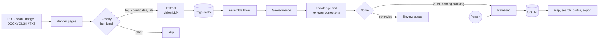

# Borehole Atlas

Black Forest Hackathon 2026 – Smart Automation Edition (16–18 Oct 2026, Offenburg).
Challenge by **Herrenknecht AG**: *automated extraction and standardisation of drilling data for a global
geodatabase.*

Borehole Atlas reads borehole logs from PDFs, scans, images and Word files, converts them into one standard
record, georeferences them and stores them in a searchable database with a world map. A vision LLM reads the
pages; our code decides what a value means, where the hole is and whether the record can be trusted.
Uncertain records go to a person. The web app carries the name **Drilldown**.

```bash
docker build -t borehole-atlas . && docker run --rm -p 8000:8000 borehole-atlas   # http://localhost:8000
```

That builds and tests everything that runs without the confidential dataset or an LLM key, and serves the app
with synthetic boreholes (see [What the build checks](#what-the-build-checks)).

**Not in this repository:** the challenge documents and everything built from them (page images, model cache,
the database with the extracted boreholes and review decisions). They are confidential project data, used only
for this challenge and deleted after the event. The Docker image and `make demo` run on synthetic boreholes at
public places; the statistics page then shows the committed evaluation snapshot
(`fixtures/model_evaluation.json`, aggregates only).

## For reviewers

- **Build and test without data or key:** the Docker build above runs lint, web unit tests, the TypeScript check,
  the production build and the full pytest suite; locally `make install && make check`.
- **Run:** UI on <http://localhost:8000>, OpenAPI on <http://localhost:8000/docs>, synthetic boreholes.
- **Extract real logs without the dataset:** [`samples/`](samples/) holds two public LGRB borehole logs;
  `make samples` runs the full pipeline on them with a model key ([Trying the public samples](#trying-the-public-samples)).
- **Architecture:** [docs/pipeline.md](docs/pipeline.md) (diagrams), [schema/README.md](schema/README.md) (record
  model and design decisions), [Repository layout](#repository-layout) (module map).
- **Core rules in code:** release score and blocking findings in [`pipeline/scoring.py`](pipeline/scoring.py),
  coordinate parsing and CRS resolution in [`pipeline/georef.py`](pipeline/georef.py), sheet assembly in
  [`pipeline/assemble.py`](pipeline/assemble.py), review persistence in [`pipeline/store.py`](pipeline/store.py)
  and [`pipeline/corrections.py`](pipeline/corrections.py).
- **Known limits:** [Limitations](#limitations).

## Challenge goal and how we meet it

> Automatically extract borehole profiles from PDFs, scans and images, convert them into a standardised
> format, georeference them and store them in a central database that can be searched via an interactive
> world map. **Success metric:** reliable extraction, standardisation, georeferencing and storage; profiles
> are searchable and shown on a world map.

| Criterion | How | Evidence |
|---|---|---|
| **Extraction** | Every page is classified on a thumbnail; only log, coordinate-table and lab pages are read at full resolution by a vision LLM (the corpus with Claude Opus 5.5) into a slim schema. Multi-sheet logs are joined in code. | 50 challenge documents, 1,037 pages, 364 holes. Against 144 records a person checked: **97.9 %** of layer boundaries found within 0.1 m (96.6 % of the model's boundaries are in the reference), **94.5 %** of the logged metres with the same lithology, **98.6 %** final depth, all groundwater levels and **97.7 %** of lab values ([Evaluation](#evaluation)). |
| **Standardisation** | One Pydantic model ([`schema/borehole.py`](schema/borehole.py)): depths in metres, lithology as DIN 4023 classes, stratigraphy code and colour, description in the original language plus English, lab values with qualifiers and ranges. | Export in Herrenknecht's *BoreholeDataFormat* (all seven sheets) and as CSV. |
| **Georeferencing** | The model copies coordinates and CRS text verbatim; code parses every notation, resolves the CRS to an EPSG code, transforms to WGS84 and checks the result against the named place. Printed coordinates are read a second time. | Notations tested with public landmarks in [`tests/test_georef.py`](tests/test_georef.py): UTM, national grids, DMS, decimal minutes, hemisphere letters, packed and unsigned values. Ambiguous or merely inferred systems never release automatically. |
| **Reliability** | Release score = min(extraction, position confidence), computed from evidence, never self-reported by the model. Blocking findings always go to review; human decisions stay bound to the record's content. | Audit of 73 randomly drawn automatic releases, each checked by a person: 0 needed a correction (95 % CI 0–5 %); checked records count as approved by a person afterwards. |
| **Storage and search** | SQLite with R-tree (map box) and FTS5 (full text), queryable layer and lab tables, every review decision logged. | Measured once with 50,000 generated holes: map points 0.8 s, list page 0.3 s, "clay between 10 and 20 m" 0.2 s ([Data model](#data-model)). |
| **World map** | React + MapLibre: clusters, filters, 3D columns, profile next to the source page, tunnel route section, similar ground. | Modelled on the LGRB borehole portal (bohrungen.lgrb-bw.de). |
| **Data security** | Pages are processed one by one, locally rendered; the model provider is a setting (Claude, zero-data-retention OpenRouter, or a local model); offline gazetteer. | [Data security](#data-security). |

The challenge owner's priorities from the event: coordinates first, quality over quantity, uncertain records to
a person. [FEATURES.md](FEATURES.md) lists every
feature and ideas for next steps; [docs/pipeline.md](docs/pipeline.md) shows the pipeline with diagrams.

## How it works



Simplified; [docs/pipeline.md](docs/pipeline.md) has the full diagrams with lab sheets and combined copies.
Only the LLM steps call a model; everything after the cache is code, so a rule change needs only
`pipeline rebuild` (seconds, free).

1. **Ingest:** every page of a PDF (text, scanned, vector-only), JPG/PNG/TIFF or DOCX (converted to PDF with LibreOffice)
   is rendered to an image; plain-text logs and Excel workbooks are laid out on A4 pages first. Text layers are
   only a hint, because many are scrambled.
2. **Classify:** a thumbnail per page; large reports contain only a few log pages.
3. **Extract:** full-resolution log pages into a slim schema: coordinates, CRS and lab values as printed, layer
   depths in metres, page regions, unreadable items. Continuation sheets get a summary of the previous sheet. IDs, CRS, WGS84, confidence and review
   state are set by code, never by the model.
4. **Assemble:** sheets joined by hole name and sheet number, coordinate tables and lab sheets linked to holes,
   copies of one hole across documents combined; depths compared with the PDF's text layer.
5. **Georeference:** see the table above. A CRS stated anywhere in a document serves logs that name none.
6. **Score and review:** see [Human in the loop](#human-in-the-loop).

## Human in the loop

- Score ≥ `AUTO_APPROVE_THRESHOLD` (0.9, shown as 90 in the UI) and no blocking finding → released
  automatically; otherwise the record waits in the review queue, weakest first.
- Blocking findings ([`pipeline/scoring.py`](pipeline/scoring.py)) include layer gaps or overlaps, depth contradictions, an ambiguous coordinate system, a second coordinate
  reading that disagrees, a position far from the document's other holes (checked again after reviewer
  corrections), copies of a hole that disagree on depths or on the lithology at the same boundaries, an empty or
  lost log page, missing sheets, depths in feet and text that addresses the model.
- An inferred coordinate system, or a notation whose readings lie a few hundred metres apart, stays below the
  threshold until a person confirms it, once per document.
- Reviewers approve, reject or correct a value; every decision is logged with name and time. A decision holds
  while the record's content hash is unchanged. If a re-run changes the content, the record returns to the
  queue with a note and stays there on every later run until a person decides again or the content is back to
  what was approved.
- Corrections are stored apart from the extraction and applied again on every run, so they survive
  re-extraction. Reviewer knowledge generalises: a confirmed CRS counts for the country, and hand-placed holes
  become control points for a fitted local grid.
- A release audit (`pipeline eval audit`) draws automatic releases at random for a person to check and reports
  the error rate with a confidence interval.
- Exports contain released records only, unless `?status=all`.

## What the build checks

The jury's build machine has no dataset and no secrets, so the [`Dockerfile`](Dockerfile) builds and checks
exactly what runs without them:

| Stage | Checks |
|---|---|
| Web | `npm ci`, `oxlint`, unit tests, TypeScript check and production build |
| Python | `pip install`, the full test suite (390+ tests: coordinate parsing in every notation that broke, CRS resolution, sheet assembly, scoring and blocking rules, review persistence, corrections, API, upload queue, export) |
| App | creates a database of synthetic boreholes at public places (`fixtures/demo_data.py`) and serves API and UI on port 8000 |

Not part of the build: extraction itself, which needs an LLM key and documents ([public samples](#trying-the-public-samples)
are in the repository). Tests never call an LLM; they use cached or hand-written page results. The same checks run locally with `make check`.

## Getting started

| Tool | Version | Needed for |
|---|---|---|
| Python | 3.12 or newer | pipeline and API |
| Node.js | 22.18 or newer (the Docker build uses 24) | web UI; the unit tests run TypeScript natively |
| OpenRouter key | `sk-or-…` from openrouter.ai | processing documents and web uploads only |
| LibreOffice | any recent | optional: renders DOCX files (`brew install --cask libreoffice`, `apt install libreoffice-writer-nogui`; the Docker image installs it); without it only their embedded images are read |

No database server or GIS stack: storage is one SQLite file and coordinate transformations use pyproj.

```bash
make install                      # .venv, Python packages, web packages
make check                        # tests, lint, type check, build
make demo                         # synthetic database in data/demo.sqlite
DB_PATH=data/demo.sqlite .venv/bin/uvicorn api.main:app --port 8000   # terminal 1
npm --prefix web run dev                                               # terminal 2: http://localhost:5173
```

The header shows "Synthetic demo data" while the API serves the demo database; demo records have no source
pages. After `npm --prefix web run build` the API serves the UI on port 8000 as well.

### Trying the public samples

[`samples/`](samples/) holds two public borehole logs from the LGRB portal, so the extraction can run without
the confidential dataset. With a model key in `.env` (see below):

```bash
make samples                                                     # 2 pages, a few cents
DATA_DIR=data/samples .venv/bin/uvicorn api.main:app --port 8000   # http://localhost:8000 after a web build
```

Pages, cache and database go to `data/samples/`, apart from any other run.

### Processing the challenge documents

The dataset is confidential and git-ignored. Unpack it to `temp/HKBoreholeChallenge_Data_BFH2026/` (or set
`DATASET_DIR`). Optionally download the offline gazetteer for the place check (GeoNames,
[CC BY 4.0](https://creativecommons.org/licenses/by/4.0/)):

```bash
.venv/bin/python -m pipeline.gazetteer download
```

Without a `.env` the pipeline uses the Anthropic API (`LLM_BACKEND=api`). The template reaches the model through
OpenRouter instead, with **Claude Haiku 5.5** for classification and extraction, which suits fast, cheap web
uploads. Copy the settings and put in your OpenRouter key:

```bash
cp .env.example .env        # git-ignored; replace sk-or-... with your key
```

```dotenv
LLM_BACKEND=openai
OPENAI_BASE_URL=https://openrouter.ai/api/v1
OPENAI_API_KEY=sk-or-...   # your OpenRouter key
CLASSIFY_MODEL=anthropic/claude-haiku-5.5
EXTRACT_MODEL=anthropic/claude-haiku-5.5
```

Haiku reads a log page in about 30 s for about $0.005, roughly 1/30 of Opus; Opus 5.5 is more precise on layer
boundaries, groundwater and lab values ([model comparison](docs/model-comparison.md)). For the most accurate
run, set both models to `anthropic/claude-opus-5.5`. Requests go only to providers with zero data retention
(`OPENROUTER_ZDR=1`); the cost of every call is stored with the cached answer, and `pipeline estimate` sums it.
Other ways to reach a model are under [Other model backends](#other-model-backends).

```bash
.venv/bin/python -m pipeline ingest              # render all pages, list document ids (no model calls)
.venv/bin/python -m pipeline estimate            # page count and cost before a run
.venv/bin/python -m pipeline run --doc <id>      # one document; --max-pages N for a cheap test
.venv/bin/python -m pipeline run --all --yes     # everything (~1,000 pages)
.venv/bin/python -m pipeline rebuild             # reassemble from the cache after a code change (free)
.venv/bin/uvicorn api.main:app --port 8000
```

`--doc` takes a document id (relative path without extension, folders joined by `__`) or a folder prefix, and
can be repeated. Every model answer is cached per page with the model and effort that produced it:
interrupted runs resume, repeated runs are free, and a page is read again only when its image, the prompt
version or the model changes. Runs above about $5 ask for `--yes`.

Web uploads take several files or a ZIP as one batch (up to `MAX_UPLOAD_PAGES` pages): one document group,
processed in one run, so a hole spread over several files is combined. A file sent before (same SHA-256) is left
out and reported. A queued or running batch, or single documents of it, can be cancelled: no new model calls
start for them and nothing is stored for them. When a batch is done, its first hole opens. The queue lives in
SQLite and survives a restart; run one API process per database.

`pipeline share --out <dir>` packs a consistent copy of the database and page images for a teammate. The
package is confidential: pass it on locally (AirDrop, USB, `scp`), never through a cloud service.

## Using the app

- **Map:** clusters by location, colour by release state, a ring for a position estimated from a place name.
  From zoom 15, holes become 3D columns with lithology bands at a 1:1 metre scale; "3D view" in the menu switches
  to a flat, north-up 2D map with points.
- **Header:** released and total records, and the number of holes without a position, which opens them in the
  review list.
- **Search and filters:** full text over names, projects, places and layer descriptions; release state and
  score range, lithology, depth to rock, groundwater. The list groups holes by project; "Show on map" narrows the
  map to one. A **Group results** switch, remembered in the browser, turns grouping on or off in the result,
  review and tunnel lists.
- **Detail:** two-column profile (stratigraphy, DIN 4023 lithology), layers, tests and lab values; the
  **Source** tab opens the original page beside them, and hovering a value outlines where it was read. Findings
  are split into what needs a person, other findings and what the model could not read. Each card is edited in
  place. "Similar ground elsewhere" lists holes of other documents with comparable ground; "Find more like this"
  sets the ground filters from the open hole, and a hole opened from the list leads back with one button.
- **Review:** choose **Review** beside the borehole filters. The left sidebar shows waiting records,
  lowest score first, also those without a position, grouped by project with count and release share; use the
  active **Review ×** button to return to boreholes. Filter them by release state and score, by where the
  position comes from (printed coordinates, estimated from the place name, inferred coordinate system, none) and
  by finding. Approve with `A`, reject with `R`, `Esc` to close; the next record opens automatically. A
  document whose waiting holes share an inferred coordinate system shows "Confirm for all n" in the detail of
  each of them. The statistics open the release audit sample in the same list.
- **Tunnel routes:** choose **Tunnels** beside the borehole filters. The sidebar groups saved tunnels by the
  project shared by the most selected boreholes; tunnels without a project appear first. Use **+ New tunnel**
  at the top of the tunnel list to create one. Its settings open on the right. Draw an alignment or import a WGS84 GeoJSON
  LineString, select boreholes in the corridor, and view the longitudinal section below the map. Spans over
  150 m are drawn lighter as less certain. The other saved tunnels stay visible on the map. Tunnels and selected
  boreholes are saved in this browser, and the selected tunnel reopens from its URL after a reload.
- **Statistics:** four tabs. **Overview** opens with three headline figures over the whole database, each
  leading to its evidence: share of holes positioned from printed coordinates, layer boundaries found in the
  human-checked records, and audited automatic releases found wrong. Below, for the current filter: a coordinates
  section (how each position was obtained, how the coordinate system was settled, EPSG codes, position error on
  the checked records, positions deliberately left for a reviewer), the release funnel, and under **More
  figures** key figures, release state, final depths, lithology, findings and documents with their most frequent
  finding. Figures from the committed evaluation snapshot say so. **How it works**: the steps from page to
  record, the release score rules and the principles behind them. **Models**: every tested model, measured on
  the checked records or screened against the reference model, with cost and time per page. **Details**:
  extraction quality, the release audit, the full model comparison, the wider benchmark, the prompt versions and
  the recorded model calls.
- **Export:** released records as BoreholeDataFormat workbook or CSV, one row per layer.

## Evaluation

```bash
.venv/bin/python -m pipeline eval snapshot      # records a person approved become the reference
.venv/bin/python -m pipeline eval               # model output (before corrections) against the reference
.venv/bin/python -m pipeline eval audit         # draw automatic releases for a person to check
.venv/bin/python -m pipeline eval snapshot-models  # aggregates for the statistics page (fixtures/, committed)
```

`eval` compares the model's own output, before reviewer corrections, so a fixed record still counts the
model's mistake. Columns: boundaries found within 0.1 m and their precision, primary lithology per layer and
per metre of log, position error and EPSG code, final depth, groundwater levels, lab values. The reference was
approved from the pipeline's own output, which flatters it somewhat; a fresh re-extraction of 26 reference
records with Opus finds 96.1 % of the boundaries (arm `baseline-rerun` in the snapshot).

A prompt change is tried on the reference documents before it becomes the next `PROMPT_VERSION`
(`pipeline experiment init|run|compare`): each arm has its own cache and a fresh database without corrections,
so the scores are the model's alone. The same commands compare models;
[docs/model-comparison.md](docs/model-comparison.md) compares Opus 5.5 with Haiku 5.5 on quality, time and
cost. The statistics page computes the same figures live from `data/eval`; without it (e.g. in the Docker
image) it shows `fixtures/model_evaluation.json`, which holds aggregates only. [docs/prompt-backlog.md](docs/prompt-backlog.md) collects prompt changes for the next version.

## Data model

One SQLite file; the schema version is in `PRAGMA user_version`. The API and the pipeline create or upgrade it
once at start (`store.migrate`); files older than version 3 are refused.

| Table | Content |
|---|---|
| `boreholes` | one row per hole: the canonical record as JSON plus summary columns and its document group (`grp`); a durable `uid` survives renames (aliases in `borehole_aliases`) |
| `layers`, `lab_values`, `findings`, `record_sources` | queryable projections and source pages, rebuilt with every record |
| `boreholes_rtree`, `boreholes_fts` | map box and full-text search |
| `review_events`, `record_versions` | every decision, and the exact content it was about; versions that neither a decision nor a current record points to are dropped |
| `corrections`, `knowledge` | human input, applied again on every run |
| `documents`, `pages`, `upload_jobs` | inputs and the web upload queue |
| `llm_calls` | every model call a run made: what went where, as sizes |

Measured once on a laptop with 50,000 generated holes (1 GB): map points 0.8 s / 1.5 MB gzipped, a list page 0.3 s, "clay between
10 and 20 m" 0.2 s, "UCS ≥ 80 MPa" 0.1 s, a review-queue page 6 ms; the CSV export streams from the first row.

## Repository layout

| Path | Content |
|---|---|
| `schema/` | canonical Pydantic model, generated JSON Schema, mapping to the BoreholeDataFormat |
| `pipeline/` | the pipeline and its CLI `python -m pipeline`, one module per step (below) |
| `api/` | FastAPI: search, map data, detail, source pages, review, corrections, upload, statistics, export |
| `web/` | React 19, Vite, TypeScript, MapLibre |
| `tests/` | pytest suite; public landmarks and invented values only |
| `fixtures/` | synthetic demo boreholes, evaluation snapshot for the statistics page (aggregates only) |
| `samples/` | two public LGRB borehole logs for an extraction run without the dataset |
| `docs/` | pipeline diagrams, model comparison, prompt backlog |
| `temp/`, `data/` | dataset, pages, cache and database: confidential and git-ignored |

| Module in `pipeline/` | Step |
|---|---|
| `ingest` | discover files, render pages, text layers |
| `llm`, `extraction_models` | classification and extraction calls, page cache, the slim extraction schema |
| `runner`, `uploads` | command-line runs and the web upload queue |
| `assemble` | join sheets into holes, link coordinate tables and lab sheets |
| `identity`, `labs`, `dedupe` | hole names and ids, lab values and units, copies of a hole across documents combined |
| `georef`, `coordcheck`, `gazetteer` | parse coordinates, resolve the CRS, second coordinate reading, offline place lookup |
| `knowledge`, `corrections` | reviewer knowledge and corrections applied on every run |
| `scoring`, `injection` | release score, findings, prompt-injection check |
| `ground` | rock head and groundwater level derived from the layers, for search and tunnel sections |
| `store` | SQLite schema, migration, review persistence |
| `export` | BoreholeDataFormat workbook and CSV |
| `evaluate`, `quality`, `experiment` | evaluation against the reference, aggregates for the statistics page, prompt and model experiments |

## Configuration

Environment variables, from the shell or `.env`:

| Variable | Default | Purpose |
|---|---|---|
| `LLM_BACKEND` | `api` (`openai` in `.env.example`) | `openai` (OpenRouter, Ollama), `api` (Anthropic API) or `claude-code` (CLI) |
| `OPENAI_BASE_URL` / `OPENAI_API_KEY` | `http://localhost:11434/v1` / – | server and key for `openai`; OpenRouter in `.env.example` |
| `ANTHROPIC_API_KEY` | – | key for `api` |
| `OPENROUTER_ZDR` | `1` | OpenRouter: zero-data-retention providers only |
| `CLAUDE_CLI`, `CLAUDE_CONFIG_DIR`, `CLAUDE_CLI_TOKEN_FILE` | `claude`, CLI default, – | CLI backend and its account |
| `CLASSIFY_MODEL` / `CLASSIFY_EFFORT` | `claude-opus-5-5` / `low` | page classification (`anthropic/claude-haiku-5.5` in `.env.example`) |
| `EXTRACT_MODEL` / `EXTRACT_EFFORT` | `claude-opus-5-5` / `medium` | log extraction (`anthropic/claude-haiku-5.5` in `.env.example`) |
| `COORDS_EFFORT` | `low` | second reading of printed coordinates, with `EXTRACT_MODEL` |
| `MAX_WORKERS` | `6` (API), `3` (CLI) | parallel model calls |
| `AUTO_APPROVE_THRESHOLD` | `0.9` | release score for automatic release |
| `MAX_UPLOAD_PAGES` / `MAX_UPLOAD_BYTES` | `100` / 25 MB | pages and bytes per upload batch |
| `MAX_UPLOAD_FILES` | `1000` | documents per upload batch, ZIP entries included, checked before extraction |
| `MAX_UPLOAD_JOBS` / `MAX_UPLOAD_WORKERS` | `8` / `1` | web upload queue |
| `MAX_UPLOAD_CALLS` / `MAX_DAILY_CALLS` | `400` / `2000` | model calls per upload batch / per UTC day (command-line runs count towards the day, but are not stopped) |
| `DATASET_DIR` | `temp/HKBoreholeChallenge_Data_BFH2026/BoreholeData` | input documents |
| `DATA_DIR` / `DB_PATH` | `data` / `data/boreholes.sqlite` | pages, cache, database |
| `GAZETTEER_PATH` | `data/gazetteer.sqlite` | offline GeoNames index |
| `EXTRACT_LONG_EDGE` / `THUMB_LONG_EDGE` | `2000` / `900` | rendering size in pixels |

Deleting the database and running `rebuild` restores every record from the cache, but **review decisions and
corrections are lost**.

## Troubleshooting

| Symptom | Cause and fix |
|---|---|
| `No key for https://openrouter.ai/api/v1` | No `.env` in the project root, or `OPENAI_API_KEY` is missing in it. |
| OpenRouter answers `401` | `OPENAI_API_KEY` in `.env` is still the placeholder `sk-or-...`. |
| OpenRouter: "no endpoints found" | The model has no zero-data-retention provider; pick another model or set `OPENROUTER_ZDR=0` if that is acceptable. |
| `401 invalid x-api-key` (`LLM_BACKEND=api`) | The key is a subscription token, not an API key; see [Other model backends](#other-model-backends). |
| Map stays empty, "Worker failed to load" | Old UI build: `npm --prefix web run build`, or restart the dev server. |
| "No source page stored" on every record | The API serves the demo database; restart it without `DB_PATH`. |
| "kept previous results for incomplete documents" | Some pages failed (rate limit, timeout); run again, finished pages come from the cache. |
| Records unchanged after a code change | `pipeline rebuild`, then reload the UI. |

## Other model backends

<details>
<summary>Anthropic API, Claude subscription through the Claude Code CLI, or a local model</summary>

The model backend is one setting in `.env`; prompts, schemas and the cache work the same with each.

**Claude Code CLI (Claude subscription).** With the `claude` CLI installed and logged in, the pipeline calls it in
print mode and uses the subscription instead of a key. Slower and bound to the subscription's usage limits; the
corpus was extracted this way with Opus:

```dotenv
LLM_BACKEND=claude-code
CLASSIFY_MODEL=claude-opus-5-5
EXTRACT_MODEL=claude-opus-5-5
# another account than the CLI's default login:
# CLAUDE_CONFIG_DIR=~/.claude-other   or   CLAUDE_CLI_TOKEN_FILE=~/path/to/token
```

The CLI backend strips API keys from the environment, so `claude -p` always uses its own login.

**Anthropic API.** `LLM_BACKEND=api` with `ANTHROPIC_API_KEY=sk-ant-api03-…` from the Claude Console. A
subscription token (`sk-ant-oat…`) is not an API key and fails with `401 invalid x-api-key`; use the CLI
backend for it.

**Local model (Ollama).** `LLM_BACKEND=openai`, `OPENAI_BASE_URL=http://localhost:11434/v1`,
`EXTRACT_MODEL=qwen3-vl:8b-instruct`, `MAX_WORKERS=1`, and start Ollama with `OLLAMA_CONTEXT_LENGTH=32768`.

</details>

## Data security

The brief asks for data security at every step:

- Documents are rendered and split into pages locally; only single page images go to the model, and only to a
  provider the team approved for this data, or to a local model. The provider is one setting.
- Place names are looked up in an offline gazetteer before anything else.
- Source files, pages, cache and database stay local, in git-ignored folders, and are deleted after the event.
- Not in the prototype: user accounts (see [Limitations](#limitations)).
- Every model call of a run is recorded in `llm_calls` (document, page, stage, model, endpoint, image size and
  text length sent, tokens, cost, outcome), never its content; `GET /api/llm/usage` shows the day against the limits.
- Documents are untrusted input. Through the API backends the model has no tools; through the Claude Code CLI
  its only tool is Read, confined to a temporary folder that holds just the page image. Its answer must pass the
  schema; text that addresses the model ("ignore the previous instructions", chat markup, in English or German)
  is a blocking finding (`possible prompt injection`), so that document's records go to a person. Text inside
  page images is not scanned.

The challenge dataset contains confidential data from real projects. It is used only for this challenge, is not
shared outside the event and is deleted afterwards. Nothing from it is committed: tests, fixtures and docs use
public landmarks and invented values.

## Limitations

- No user accounts: reviewer names are free text and the write endpoints are open. Run it on a trusted network.
- One API process per database (SQLite, upload queue in the same file).
- Extraction itself needs an LLM key; the figures above cannot be reproduced without the confidential
  documents, only the run on the public samples. The build covers everything after the page cache.
- The reference was approved from the pipeline's own output, which flatters the scores (see
  [Evaluation](#evaluation)).
- Text inside page images is not scanned for prompt injection; only text layers are.
- Lithology patterns follow the DIN 4023 chart, without a claim of full compliance.
- The map receives all matching points at once, which suits up to about 100,000 holes.
