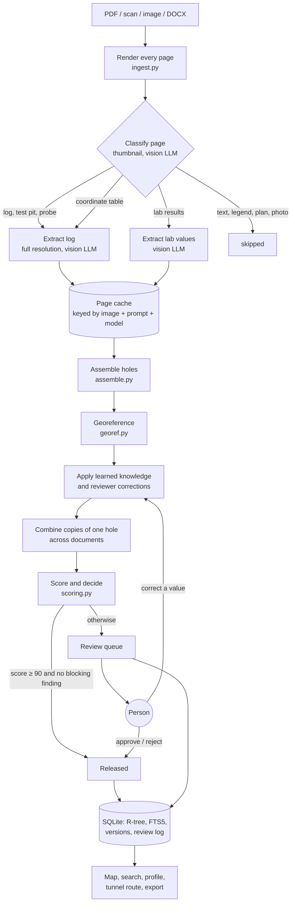
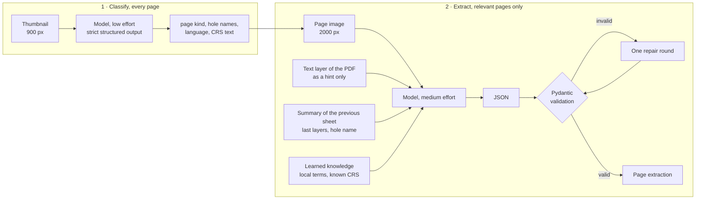
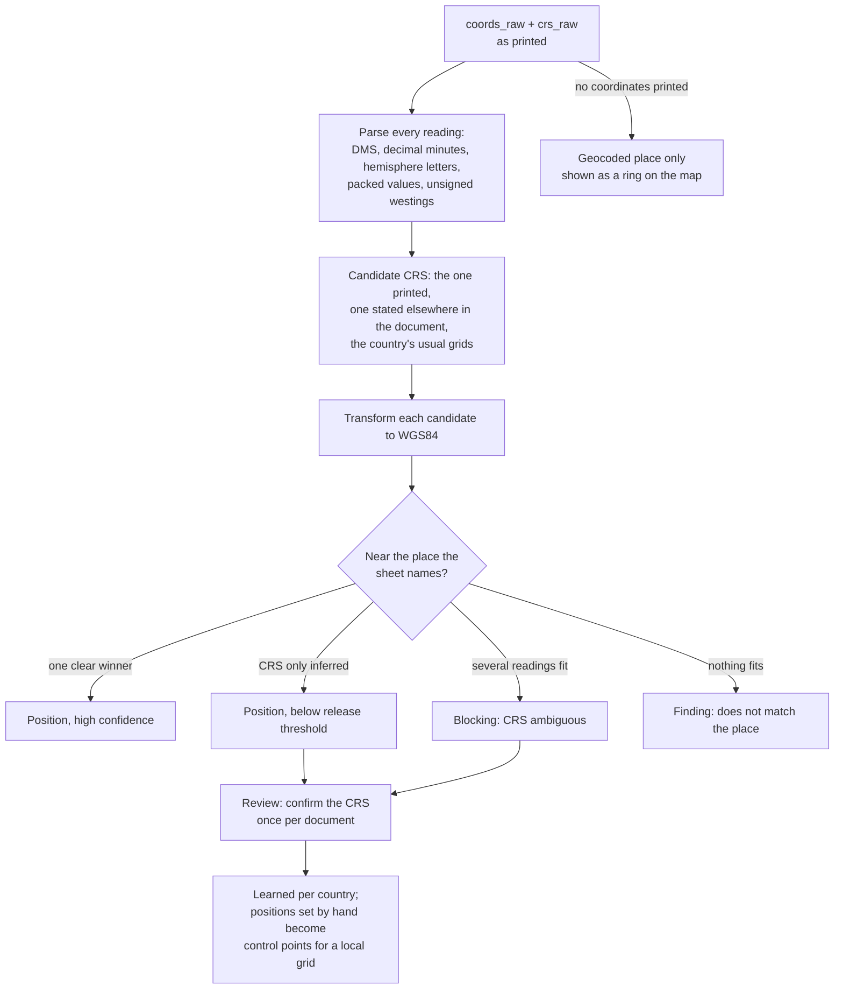
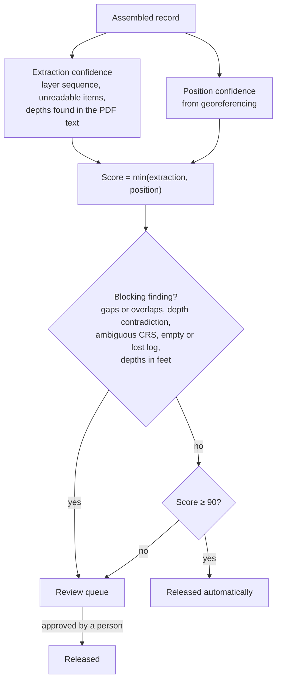

# How a document becomes a borehole record

From an uploaded file to a released record on the map: what the model reads, what our code decides, and where
a person steps in. Module names refer to `pipeline/`.

## Overview



Only the two LLM boxes call a model. Everything after the cache is code, so changing a rule means
`pipeline rebuild`: it runs in seconds and costs nothing.

## The model reads, the code decides

| The vision model does | Our code does |
|---|---|
| Says what a page is (log, continuation sheet, coordinate table, lab sheet, report text) and which hole names it shows | Picks which pages are worth a full-resolution extraction |
| Copies what is printed: hole name, sheet "2 of 3", coordinates and CRS text **verbatim**, elevation, dates | Parses coordinates in every notation, resolves the CRS to an EPSG code, transforms to WGS84 |
| Reads each layer: depths, description in the original language, an English translation, the main constituent as a DIN 4023 class, stratigraphy code and colour | Joins sheets into one hole, checks gaps and overlaps, compares the depths with the PDF's own text layer |
| Reads SPT, core runs, samples, groundwater, lab values with their qualifiers (`<5`, `5–10`) | Converts units, keeps ranges as ranges, links lab sheets to holes by name and depth |
| Estimates where the named place is, and how precise that estimate is | Uses that estimate only to check the printed coordinates, or as an approximate position when none are printed |
| Lists what it could not read | Computes the confidence; the model never scores itself |
| Marks where on the page each layer and the coordinates are printed | Outlines that region on the source page when a reviewer hovers the value |

IDs, coordinate systems, WGS84 positions, confidence and review state are never taken from the model.

## Inside the LLM steps



- Classification uses strict structured output. The extraction schema is too large for that (structured
  outputs allow at most 16 nullable and 24 optional parameters), so the model returns JSON that Pydantic
  validates locally.
- Continuation sheets run in page order, each with a summary of the sheet before. Independent logs run in
  parallel.
- Every answer is cached per page. An interrupted run resumes, and a page is extracted again only when its
  image, the prompt version or the model changes.
- The backend is a setting: Claude through the API or a subscription, OpenRouter, or a local model. The corpus
  runs on Opus; live web uploads use Haiku for speed (comparison in [model-comparison.md](model-comparison.md)).

## Example: one page in, one record out

Invented values, for illustration only.

```text
Printed on the sheet                      Model output (excerpt)                 Stored record (code)
─────────────────────────────────────     ─────────────────────────────────      ───────────────────────────────
BOREHOLE BH-1        Sheet 1 of 2         name: "BH-1", sheet: "1 of 2"          id: <group>:borehole:BH-1
UTM 32N  E 421 650  N 5 369 084           coords_raw: "E 421 650 N 5 369 084"    EPSG 32632 → 48.47 N, 7.94 E
                                          crs_raw: "UTM 32N"                     position confidence 0.95
Ground level 165.2 m a.s.l.               elevation_raw: "165.2 m a.s.l."        elevation 165.2 m
0.00 – 0.40  Topsoil, brown               layer 0.0–0.4, primary: topsoil        joined with sheet 2,
0.40 – 3.10  Clay, silty, stiff, grey     layer 0.4–3.1, primary: clay,          no gaps, depths found in
                                            secondary: silt (slightly)            the PDF text → confirmed
3.10 – 6.00  Sandstone, weathered         layer 3.1–6.0, primary: sandstone      rock head 3.1 m
Water struck at 2.4 m                     groundwater 2.4 m, struck              score 0.95 → released
```

## Georeferencing



## Release decision



A person's decision holds as long as the record's content is unchanged. When a re-run changes the content,
the record goes back to the queue with a note. Corrections are stored apart from the extraction and are applied
again on every run, so they survive re-extraction.

## Several documents, one hole

The same hole often appears in several files: the log itself, a coordinate table, a lab report, an older
version of the report. Within a document group the code:

1. joins continuation sheets by hole name and sheet number;
2. links coordinate tables and lab sheets to holes by name (and lab values by depth);
3. combines copies of one hole from different documents, ranking them by how they look after knowledge and
   corrections are applied; a copy with a blocking finding never leads;
4. turns a log page that came back empty, or a hole that could not be assembled, into a blocking placeholder,
   so nothing disappears silently.
